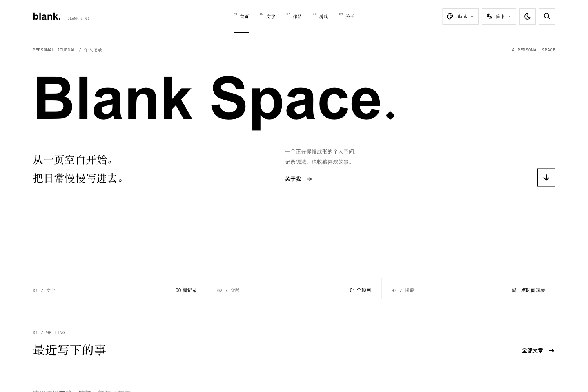
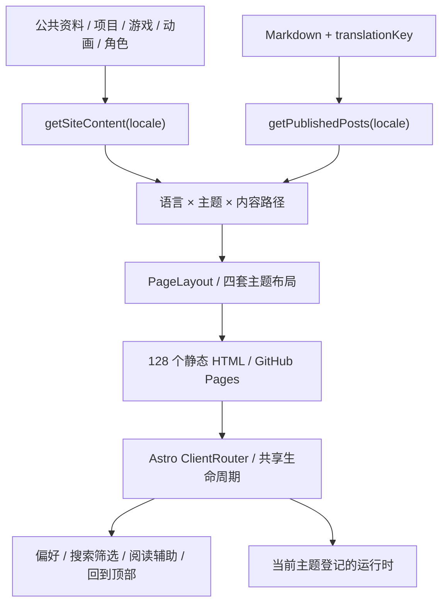

# Asahi Arataki / Personal Website

**四套界面，一份内容。** 一个从 Blank 主题发展而来的 Astro 个人网站，记录多主题、多语言、自托管字体和持续交互如何在同一个静态站点里协作。

[访问网站](https://laozhej.github.io/) · [截图画廊](gallery/README.md) · [架构](docs/01-architecture.md) · [验证记录](docs/04-validation.md) · [完整源码](../)

## 项目概况

| 项目 | 说明 |
| --- | --- |
| 作者 | Asahi Arataki（[@laozhej](https://github.com/laozhej)） |
| 形态 | Astro 7.3.5 静态网站，GitHub Actions（Node 24）构建并部署到 GitHub Pages |
| 界面 | Blank 黑白阅读、艾玛「樱色档案」、终末地工业风、明日方舟 |
| 语言 | 简体中文、台湾繁体中文、日语、英语（4 主题 × 4 语言，共 128 个静态页面） |
| 技术 | Astro、TypeScript、原生 JavaScript / CSS、HTML5 Audio、View Transitions、自托管中英日字体子集 |
| 核心结构 | 公共内容、国际化与交互在 `src/core`，四套主题呈现在 `src/themes` |
| 当前内容 | 个人资料、联系方式、项目记录、23 款游戏架、6 部动画与 67 位角色收藏、1 篇四语博客文章（`dev-log-01`）；樱色便笺暂下架（实现保留） |
| 案例更新 | 2026-11-28（基于 `main` [`f80b3e3`](https://github.com/laozhej/laozhej.github.io/commit/f80b3e31fb491a083e17f00d2bf8b1428801680d) 及文案与字体同步）；画廊 PNG 仍保留 2026-10-31 历史快照，待页头美术定稿后统一重拍 |

本目录是网站源码仓库中的工程案例。读者可以沿链接查看完整实现并在仓库根目录运行项目；案例正文以简体中文维护。

## 要解决的问题

个人网站需要同时容纳安静的黑白阅读、带角色与场景的个人手账、结构硬朗的工业手册，以及档案终端界面。如果拆成四个独立站点，每次修改简介、增补收藏或修补无障碍细节，都要重复维护四遍。

这个项目把内容身份、语言路由、颜色与动效偏好、搜索筛选和页面生命周期集中到公共层，让四套主题独立决定布局、字形、配色与动效。访客切换主题时停留在当前栏目和文章；切换语言时保持当前主题与查询状态。

## 四种视觉表达

| 主题 | 设计方向 | 体验入口 |
| --- | --- | --- |
| **Blank** | 黑白留白、思源黑体／思源宋体、编号行与细线，以阅读和归档为中心 | [打开 Blank](https://laozhej.github.io/) |
| **樱色档案 / Ema** | 全屏立绘舞台、五幕姿态切换、手绘分镜静物、水平章节轨、标签雨与三首 MP3 樱色电台 | [打开樱色档案](https://laozhej.github.io/themes/ema/) |
| **终末地工业风** | 纸色与墨色、单一亮黄强调、切角控件、等高线底纹与短促机械交互动效 | [打开工业风](https://laozhej.github.io/themes/endfield/) |
| **明日方舟** | 深色终端与浅色档案纸、单一青色信号、右侧进度区段栏、点阵编号牌与竖条游戏面板 | [打开明日方舟](https://laozhej.github.io/themes/arknights/) |

各主题首页独立编排；樱色档案还有定制的作品页、游戏架和关于页，终末地与明日方舟的内页复用 Blank 页面组件并由各自样式表呈现。[设计与交互说明 →](docs/02-design-and-interaction.md)

## 架构一览

主题路由由 URL 决定，保存的偏好不会强行覆盖显式主题链接。页面脚本在替换前清理，在新页面挂载；公共层通过运行时登记表调用主题脚本，不直接导入具体主题。[架构与取舍 →](docs/01-architecture.md)

## 值得看的实现

| 问题 | 实现与阅读重点 |
| --- | --- |
| 换主题时保留语言、栏目、查询和锚点 | [`routing.mjs`](../src/core/themes/routing.mjs)：把语言、主题和内容路径分开组合 |
| 译文缺失时保持内容身份 | [`select-posts.mjs`](../src/core/content/select-posts.mjs)：按 `translationKey` 选译文，缺失时保留中文原文并提示 |
| 无语言前缀入口自动匹配浏览器语言 | [`LanguagePreference.astro`](../src/core/i18n/LanguagePreference.astro)：保存偏好优先，未匹配时回退英语，并在脚本下载前拦截早期点击 |
| 客户端换页后避免重复监听或遗留状态 | [`lifecycle.mjs`](../src/core/navigation/lifecycle.mjs)、[`runtime.mjs`](../src/core/themes/runtime.mjs)：清理、挂载、滚动恢复与延迟登记 |
| 新部署后避免取回旧缓存 HTML | [`request-version.mjs`](../src/core/navigation/request-version.mjs)：请求带构建号，地址栏保留原 URL |
| 多主题共享深浅色与动效偏好 | [`color-mode.mjs`](../src/core/preferences/color-mode.mjs)、[`motion.mjs`](../src/core/preferences/motion.mjs)：切回系统模式自动恢复跟随系统，View Transitions 揭开动效 |
| 四套主题全站自托管中英日字体 | [`subsets.css`](../src/core/fonts/subsets.css)、[`FontLinks.astro`](../src/core/fonts/FontLinks.astro)：12 个页面用字精简子集 + 加载后空闲补字分片 |
| 电台跨樱色档案页面续播 | [`radio.mjs`](../src/themes/ema/lib/radio.mjs)：点击后懒加载 MP3、页间持有与离题延迟暂停 |
| 宽屏同比缩放同时照顾短屏 | [`fluid-px.mjs`](../src/core/styles/fluid-px.mjs)、[`scale.css`](../src/core/styles/scale.css)：构建转换与视口高度约束 |

完整源码已经公开，因此这里直接链接实际模块，避免另存会过期的代码摘录。

## 如何判断做成了

本次案例同步在 Node 24.19.0 下运行了完整测试、生产构建与展示校验：**255 项单元测试全部通过，构建生成 128 个静态页面**，覆盖路由、多语言、偏好、页面生命周期、集合筛选、平滑回顶、自托管字体、无障碍名称、触控目标以及四套主题各自的运行时与样式隔离；Chrome 158 的窄视口与交互检查记录在[验证说明](docs/04-validation.md)和 [`browser-checks.json`](browser-checks.json) 中。

这些结果仅代表当前检查范围通过。真实 Safari、Firefox 与实体手机测试尚未覆盖，不据此宣称已完成跨设备兼容验证。

## 开发与贡献

项目基于 Yuimi-chaya 的 Blank 主题独立化，并持续扩展主题、内容和公共模块。网站内容、视觉方向与验收由 Asahi Arataki 负责；Claude 与 Codex 等 AI 工具辅助前端设计、实现、测试与文档整理。仓库提交与测试提供完整可追溯记录。[协作与复盘 →](docs/05-process-and-retrospective.md)

## 阅读路径

1. [架构与设计取舍](docs/01-architecture.md)
2. [四套界面与交互](docs/02-design-and-interaction.md)
3. [四种语言与内容身份](docs/03-internationalization.md)
4. [验证范围、结果与复现](docs/04-validation.md)
5. [开发协作与后续方向](docs/05-process-and-retrospective.md)
6. [桌面与手机截图（历史快照）](gallery/README.md)
7. [来源与许可](provenance.md)

## English overview

This engineering case study documents an Astro personal website with four visual themes (Blank, Sakura Archive / Ema, Endfield Industrial, and Arknights) and four locales (`zh-CN`, `zh-TW`, `ja`, `en`), generating 128 static pages. Shared content, route composition, preferences, self-hosted font subsets, and page lifecycle code let all four interfaces evolve together. The detailed case study is written in Simplified Chinese; the six gallery PNGs remain a 2026-10-31 snapshot pending updated artwork, while the architecture notes and automated browser checks reflect the current site.

## 来源与许可

Blank 基础主题、字体、图标与第三方媒体均保留各自来源。软件采用仓库中的 [MIT 许可](../LICENSE)；站内第三方角色、游戏宣传图、动画封面与音频不因此获得 MIT 授权。[来源与许可说明](provenance.md)列出对应清单和边界。
