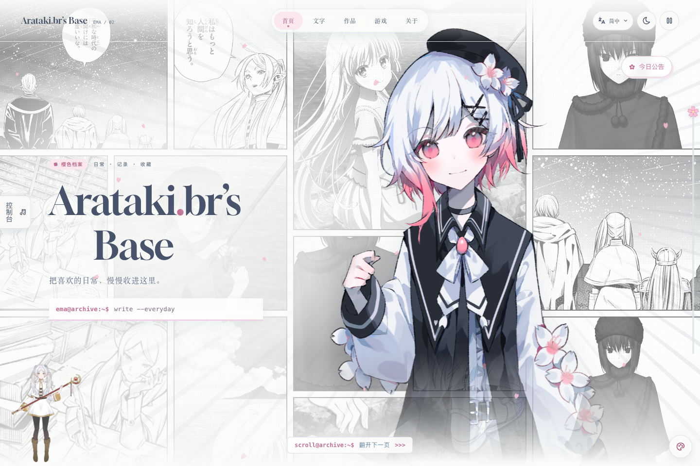
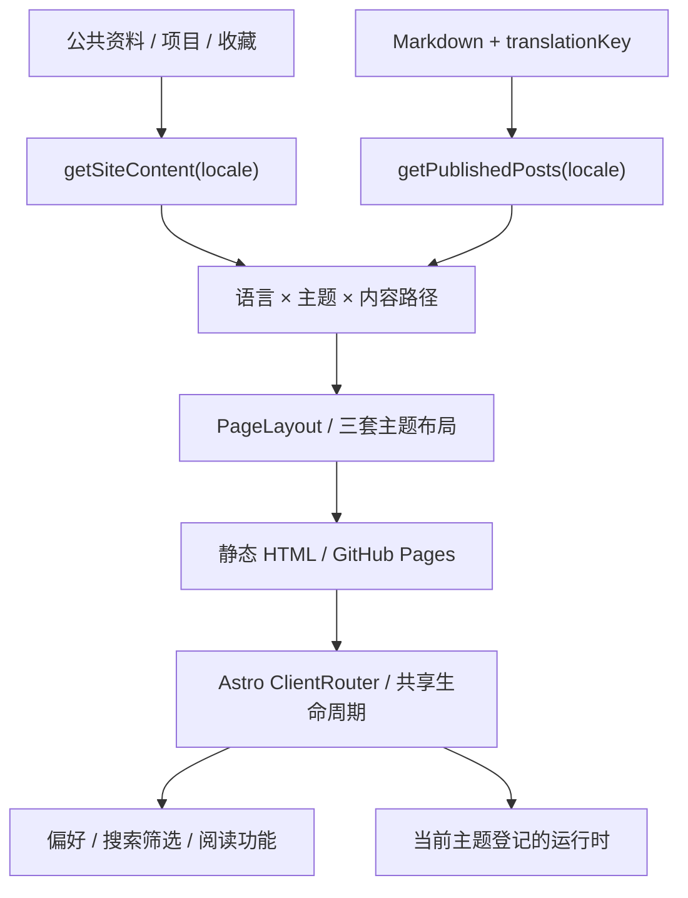

# Asahi Arataki / Personal Website

**三套界面，一份内容。** 一个从 Blank 主题发展而来的 Astro 个人网站，记录多主题、多语言和持续交互如何在同一个静态站点里协作。

[访问网站](https://laozhej.github.io/) · [截图画廊](gallery/README.md) · [架构](docs/01-architecture.md) · [验证记录](docs/04-validation.md) · [完整源码](../)

## 项目概况

| 项目 | 说明 |
| --- | --- |
| 作者 | Asahi Arataki（[@laozhej](https://github.com/laozhej)） |
| 形态 | Astro 静态网站，GitHub Actions 构建并部署到 GitHub Pages |
| 界面 | Blank 黑白阅读、艾玛「樱色档案」、终末地工业风 |
| 语言 | 简体中文、台湾繁体中文、日语、英语 |
| 技术 | Astro、TypeScript、原生 JavaScript / CSS、Web Audio；艾玛看板娘使用 PixiJS / Live2D |
| 核心结构 | 公共内容与功能在 `src/core`，主题呈现在 `src/themes` |
| 当前内容 | 个人资料、游戏与动画收藏、角色、项目和每日便笺；博客文章尚未发布 |
| 展示快照 | 2026-10-31；网站实现基线 [`de9b413`](https://github.com/laozhej/laozhej.github.io/commit/de9b413e6944d27f3c105c53f85ddf9a160d7deb) |

本目录是网站源码仓库中的工程案例。读者可以沿链接查看完整实现并在仓库根目录运行项目；截图是本地生产构建的真实画面，未使用生成式 AI 制作。案例正文以简体中文维护。

## 要解决的问题

个人网站需要同时容纳安静的阅读、带有角色和场景的个人表达，以及结构鲜明的工业界面。如果把它们做成三个独立站点，每次修改简介、增加收藏或修复搜索，都可能需要重复维护。

这个项目把内容身份、语言、偏好与公共交互集中管理，让主题可以改变布局、字形、配色和体验。访客切换外观时，仍然留在同一个栏目；切换语言时，仍然可以找到同一篇文章或同一个收藏条目。

## 三种视觉表达

| 主题 | 设计方向 | 体验入口 |
| --- | --- | --- |
| **Blank** | 宋体中文、黑白、留白与编号行，以阅读和归档为中心 | [打开 Blank](https://laozhej.github.io/) |
| **樱色档案 / Ema** | 漫画分镜、角色立绘、樱花、滚动场景、便笺、电台与看板娘 | [打开樱色档案](https://laozhej.github.io/themes/ema/) |
| **终末地工业风** | 纸色与墨色、黄色强调、切角、编号及等高线背景 | [打开工业风](https://laozhej.github.io/themes/endfield/) |

首页可以各自表达；作品、文章等页面则复用公共内容和功能标记，由当前主题布局呈现。共享核心不要求三套主题拥有完全相同的控件或装饰。[设计与交互说明 →](docs/02-design-and-interaction.md)

## 架构一览

主题路由由 URL 决定；保存的偏好不会强行覆盖直接链接。页面脚本在替换前清理，在新页面挂载。公共核心通过运行时登记调用主题增强，避免导航模块直接导入具体主题。[架构与取舍 →](docs/01-architecture.md)

## 值得看的实现

| 问题 | 实现与阅读重点 |
| --- | --- |
| 换主题时保留语言、栏目、查询和锚点 | [`routing.mjs`](../src/core/themes/routing.mjs)：把语言、主题和内容路径分开组合 |
| 译文缺失时保持内容身份 | [`select-posts.mjs`](../src/core/content/select-posts.mjs)：按 `translationKey` 选译文，缺失时保留中文原文 |
| 客户端换页后避免重复监听或遗留动画 | [`lifecycle.mjs`](../src/core/navigation/lifecycle.mjs)、[`runtime.mjs`](../src/core/themes/runtime.mjs)：清理、挂载与延迟登记 |
| 新版本页面避免取回旧部署的缓存 HTML | [`request-version.mjs`](../src/core/navigation/request-version.mjs)：请求带构建版本，地址栏保留原 URL |
| 多主题共享颜色与动效选择 | [`color-mode.mjs`](../src/core/preferences/color-mode.mjs)、[`motion.mjs`](../src/core/preferences/motion.mjs)：系统偏好、手动选择与存储受限回退 |
| 电台跨艾玛页面继续播放 | [`radio.mjs`](../src/themes/ema/lib/radio.mjs)：Web Audio 合成、页面持有与延迟释放 |
| 宽屏同比缩放同时照顾短屏 | [`fluid-px.mjs`](../src/core/styles/fluid-px.mjs)、[`scale.css`](../src/core/styles/scale.css)：构建转换与视口约束 |

完整源码已经公开，因此这里直接链接实际模块，避免另存一份会逐渐过期的代码摘录。

## 如何判断做成了

本次案例整理运行了现有 Node 测试和生产构建。**94 项测试通过，构建生成 84 个静态页面**。测试涉及路由、翻译选择、偏好、页面生命周期、集合功能、艾玛场景、电台及 Live2D 控制逻辑；截图与浏览器检查单独记录在[验证说明](docs/04-validation.md)中。

这些结果说明当前检查范围内的行为符合预期。性能评分、完整无障碍审核、真实移动设备和跨浏览器兼容性尚未在本次测量，不据此宣称已完成。

## 开发与贡献

项目基于 Yuimi-chaya 的 Blank 主题独立化，并继续扩展主题、内容和公共模块。网站维护与内容由 Asahi Arataki 负责；Codex 与 Claude 辅助前端设计、实现、修复及文档整理。仓库中的提交和测试提供可追溯记录。[协作与复盘 →](docs/05-process-and-retrospective.md)

## 阅读路径

1. [架构与设计取舍](docs/01-architecture.md)
2. [三套界面与交互](docs/02-design-and-interaction.md)
3. [四种语言与内容身份](docs/03-internationalization.md)
4. [验证范围、结果与复现](docs/04-validation.md)
5. [开发协作与后续方向](docs/05-process-and-retrospective.md)
6. [桌面与手机截图](gallery/README.md)
7. [来源与许可](provenance.md)

## English overview

This engineering case study documents an Astro personal website with three visual themes and four locales. Shared content, route composition, preferences, and page lifecycle code let the interfaces evolve together. The public repository contains the runnable source; this directory adds real screenshots, architectural decisions, a source tour, and scoped validation results. The detailed case study is written in Simplified Chinese.

## 来源与许可

Blank 基础主题、字体、图标、渲染库及美术素材均保留各自来源。软件采用仓库中的 [MIT 许可](../LICENSE)；截图中出现的第三方角色与图片不因此获得 MIT 授权。[来源与许可说明](provenance.md)列出对应清单和边界。
