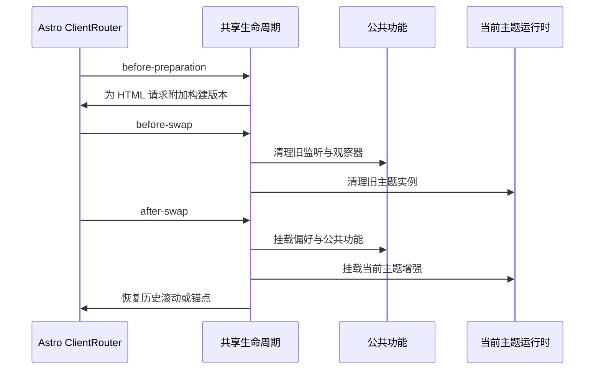

# 架构：让主题变化，让内容稳定

[返回案例首页](../README.md)

## 边界从哪里划分

网站采用 Astro 的静态输出。`src/pages` 生成路径，`src/core` 提供数据、内容选择、国际化、偏好与公共功能，`src/themes` 负责布局、样式和主题专属交互。构建结果部署到用户名站点根目录，不需要服务端数据库或运行时 API。

| 层 | 实际位置 | 职责 |
| --- | --- | --- |
| 内容源 | [`src/core/data`](../../src/core/data)、[`src/content.config.ts`](../../src/content.config.ts) | 资料、项目、收藏、便笺与文章 schema |
| 内容选择 | [`content.ts`](../../src/core/i18n/content.ts)、[`select-posts.mjs`](../../src/core/content/select-posts.mjs) | 按语言返回内容，保持条目与文章身份 |
| 路径组合 | [`i18n/routing.mjs`](../../src/core/i18n/routing.mjs)、[`themes/routing.mjs`](../../src/core/themes/routing.mjs) | 组合语言、主题、栏目和文章路径 |
| 页面呈现 | [`PageLayout.astro`](../../src/core/themes/PageLayout.astro)、[`src/themes`](../../src/themes) | 选择主题布局，渲染静态 HTML |
| 公共交互 | [`features`](../../src/core/features)、[`preferences`](../../src/core/preferences) | 搜索筛选、阅读辅助与偏好 |
| 客户端换页 | [`SiteNavigation.astro`](../../src/core/navigation/SiteNavigation.astro) | Astro ClientRouter 与统一挂载入口 |

`PageLayout.astro` 是公共核心选择具体主题布局的显式入口。公共客户端模块不导入主题实现，这项约束由 `tests/theme-runtime.test.mjs` 检查。主题依赖核心接口，核心通过登记表调用当前主题的增强。

## 一个栏目如何生成多个外观

例如 `projects` 页面读取同一个 `getSiteContent(locale)`。Blank 路径使用根目录，艾玛路径带 `/themes/ema/`，工业风路径带 `/themes/endfield/`；非简体中文的语言前缀放在主题前面。

```text
/projects/
/themes/ema/projects/
/ja/themes/ema/projects/
/en/themes/endfield/projects/
```

共享作品页面提供语义结构和 `data-site-*` 功能标记。艾玛的作品页委托给它，工业风路由也直接使用它；当前主题的布局和样式改变呈现。各主题首页与部分页面可以独立编排，因此并没有把每个页面都强制变成同一套模板。

## 换页时谁负责什么



Astro 负责获取页面、历史记录、请求取消和页面替换。项目自己的适配层负责命令式脚本的生命周期：同一个 body 不重复挂载；离开时清理；新主题脚本稍后登记时，登记表能补挂当前页面。

深浅色选择在目标文档被捕获前同步，减少换页时的颜色闪烁。暂停动效和系统减少动态都会跳过过渡。浏览器返回时，先挂载可能改变高度的首页增强，再恢复滚动位置。

## 关键取舍

| 决策 | 得到什么 | 代价与边界 |
| --- | --- | --- |
| 主题进入 URL | 链接可分享，刷新和历史记录可还原当前界面 | 生成页面数增加；新增路由需照顾所有语言与主题 |
| URL 优先于保存的主题 | 直接链接不会被偏好重定向到另一种外观 | 保存偏好与当前页面主题可能不同，二者需分开表达 |
| 静态生成 + 客户端导航 | 页面可直接访问，站内导航可连续过渡 | 脚本必须处理挂载、清理、滚动和部署缓存 |
| 内容和功能共用 | 一处修复可供各主题使用 | 主题必须渲染相应控件；共享逻辑不会自动产生界面 |
| 主题专属电台 | 艾玛页面间保持 Web Audio 引擎 | 离开艾玛后延迟停止；不承诺完整刷新后继续播放 |

新增主题的实际接入契约见[主题开发说明](../../docs/THEMES.md)。
