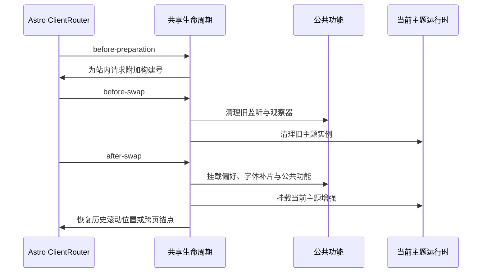

# 架构：让主题变化，让内容稳定

[返回案例首页](../README.md)

## 边界从哪里划分

网站采用 Astro 7.3.5 的静态输出。`src/pages` 生成路由，`src/core` 提供数据、内容选择、国际化、字体预加载、偏好与公共功能，`src/themes` 负责四套主题的布局、样式与专属交互。构建产物直接部署到 GitHub Pages 根目录，不需要服务端数据库或运行时 API。

| 层 | 实际位置 | 职责 |
| --- | --- | --- |
| 内容源 | [`src/core/data`](../../src/core/data)、[`src/content.config.ts`](../../src/content.config.ts)、[`src/content/blog`](../../src/content/blog) | 个人资料、联系方式、项目、游戏、动画、角色、便笺与文章集合 |
| 内容选择 | [`content.ts`](../../src/core/i18n/content.ts)、[`select-posts.mjs`](../../src/core/content/select-posts.mjs)、[`select-games.mjs`](../../src/core/content/select-games.mjs) | 按语言返回本地化资料、游戏架与文章列表，保持条目与译文身份 |
| 路径组合 | [`i18n/routing.mjs`](../../src/core/i18n/routing.mjs)、[`themes/routing.mjs`](../../src/core/themes/routing.mjs) | 组合语言、主题、栏目和文章路径，区分规范主题（canonical）与当前页 URL |
| 自托管字体 | [`subsets.css`](../../src/core/fonts/subsets.css)、[`FontLinks.astro`](../../src/core/fonts/FontLinks.astro) | 预加载当前主题与语言所需的精简子集，并在页面加载后空闲时挂载补字分片 |
| 页面呈现 | [`PageLayout.astro`](../../src/core/themes/PageLayout.astro)、[`src/themes`](../../src/themes) | 按路由选择 Blank、Ema、Endfield 或 Arknights 布局，渲染静态 HTML |
| 公共交互 | [`features`](../../src/core/features)、[`preferences`](../../src/core/preferences) | 搜索筛选排序、目录与阅读进度、折叠展开、平滑回顶、深浅色与动效偏好 |
| 客户端换页 | [`SiteNavigation.astro`](../../src/core/navigation/SiteNavigation.astro) | Astro ClientRouter、构建版本请求、悬停预取、统一生命周期与滚动恢复 |

`PageLayout.astro` 是公共核心引用主题布局的唯一显式入口。公共客户端模块不导入任何主题实现，这项边界由 [`tests/theme-runtime.test.mjs`](../../tests/theme-runtime.test.mjs) 守护。因为 `PageLayout.astro` 引入了四套布局，各主题 CSS 会随共享页到达其他主题，因此每个主题的规则必须严格限定在 `html[data-theme="…"]` 或主题专属类名之下。

## 一个栏目如何生成四套外观

以 `projects` 页面为例，四套主题都读取同一个 `getSiteContent(locale)`。明日方舟作为默认主题使用根路径，另外三套主题分别挂载在 `/themes/blank/`、`/themes/ema/` 和 `/themes/endfield/`（旧 `/themes/arknights/` 保留 `noindex` 跳转）；非简体中文的语言前缀排在主题前缀之前：

```text
/projects/
/themes/blank/projects/
/themes/ema/projects/
/ja/themes/endfield/projects/
```

Blank、终末地与明日方舟共用同一套内页组件（文字、作品、游戏、关于、致谢、404），依靠各自样式表与 `data-site-*` 钩子呈现不同外观；樱色档案的首页、作品页、游戏页与关于页则独立编排，只共享同一份数据源与筛选钩子。

## 换页时谁负责什么



Astro 负责抓取文档、管理历史记录与视图替换；公共生命周期负责命令式脚本的幂等挂载、离页清理、后退/刷新时的滚动位置二次校准，以及新主题脚本晚到时的立即补挂。

主题切换链接带有 `data-astro-reload`，以整页加载切换到目标主题，避免旧主题的测量状态与新主题的样式表冲突；同一主题内的栏目切换则使用客户端过渡，减少闪烁。

## 关键取舍

| 决策 | 得到什么 | 代价与边界 |
| --- | --- | --- |
| 主题进入 URL | 链接可分享，刷新与前进后退能还原当前界面 | 静态页面覆盖 128 个内容页（另含旧 `/themes/arknights/` 跳转页）；规范地址（canonical）与 sitemap 统一指向默认主题（明日方舟） |
| URL 优先于保存的主题 | 显式链接不会被本地偏好重定向走 | 保存的偏好与当前查看主题可能不同，状态需分开维护 |
| 静态生成 + 客户端导航 | 无 JS 仍完整可读，站内浏览过渡连续 | 脚本必须严格处理清理、滚动恢复、平滑回顶与部署缓存 |
| 双层自托管字体 | 跨平台字形一致，首屏下载量远小于整包 CJK 字体 | 内容新增较多生僻字时需要重新截取第一层子集 |
| 主题专属 MP3 电台 | 樱色档案页面间持续播放同一音频实例，点击后才下载 | 离开樱色档案后延迟暂停；整页刷新不续播 |

新主题与共享层的完整技术契约见[主题开发说明](../../docs/THEMES.md)。
