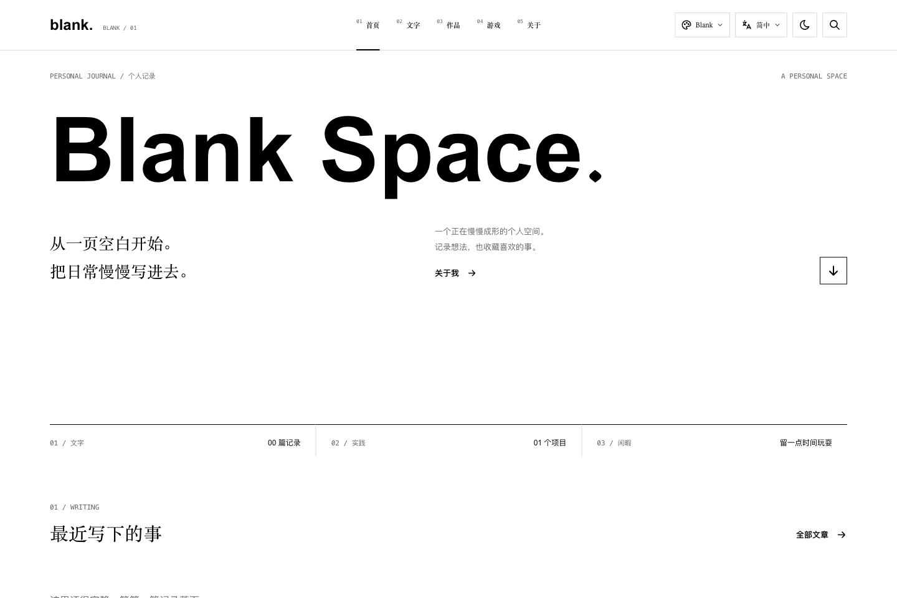
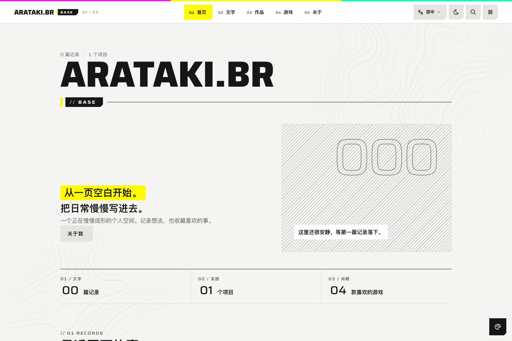
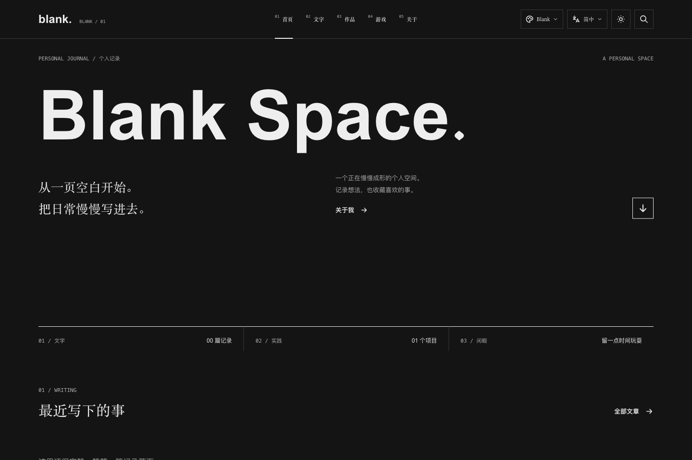
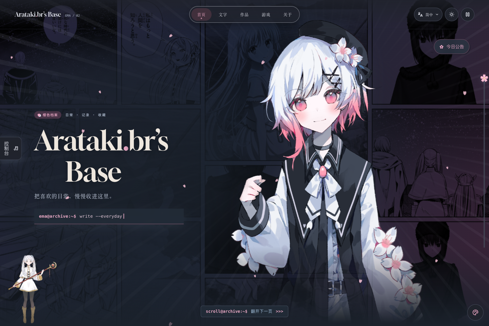
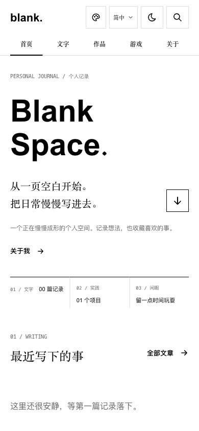
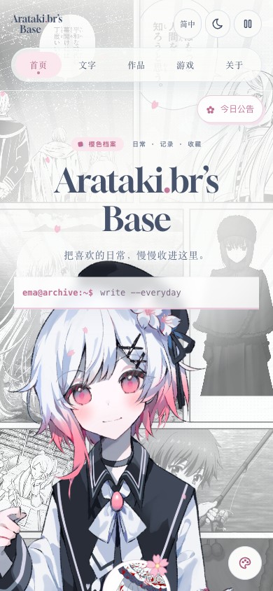
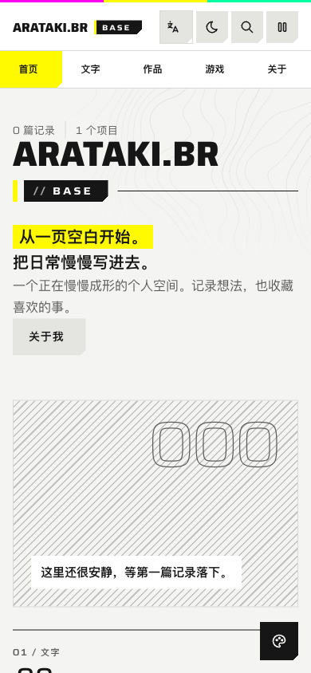
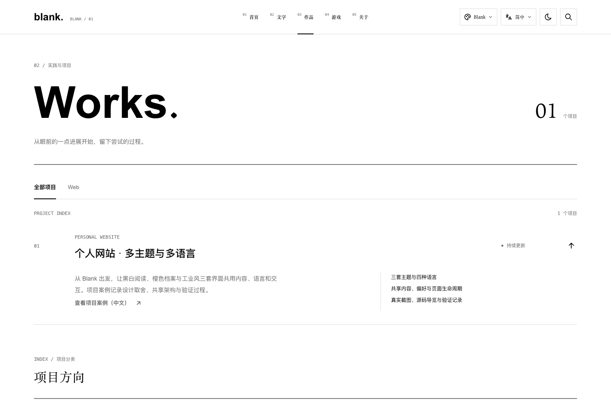

# 実際の画面 / 实际截图

[返回案例首页](../README.md)

2026-10-31 在本机以生产构建拍摄。桌面视口 1440 × 960，手机宽度视口 390 × 844，设备比例 1。手机图为桌面 Chromium 的窄视口模拟；没有据此宣称通过真实手机测试。

截图保留网站本身的第三方美术与署名。它们是界面记录，不是独立素材授权。具体路径、显示模式、尺寸和 SHA-256 见 [manifest.json](manifest.json)。

## Blank · 黑白阅读

[访问对应页面](https://laozhej.github.io/)

## 樱色档案 · 场景首页

[访问对应页面](https://laozhej.github.io/themes/ema/)

## 终末地工业风 · 结构与编号

[访问对应页面](https://laozhej.github.io/themes/endfield/)

## 浅色与深色

## 窄视口

以下图保持各自的真实视口尺寸。画面展示响应式首屏；完整页面的滚动行为需要另行操作。

| Blank | 樱色档案 | 工业风 |
| --- | --- | --- |
|  |  |  |

## 站内案例入口

[访问作品页](https://laozhej.github.io/projects/)

## 更新截图

1. 在仓库根目录构建并预览网站。
2. 按 manifest 中的路径、视口、语言与颜色模式打开页面，等待字体和图片加载。
3. 以浏览器截图覆盖对应文件，确认内容没有被弹窗、加载状态或未完成的入场动画遮住。
4. 更新 manifest 中的日期、尺寸和校验值，并重跑 `npm run showcase:check`。

截图会受系统字体、访客本地时间及动画时刻影响；这里不把静态图作为动画流畅度的证据。
