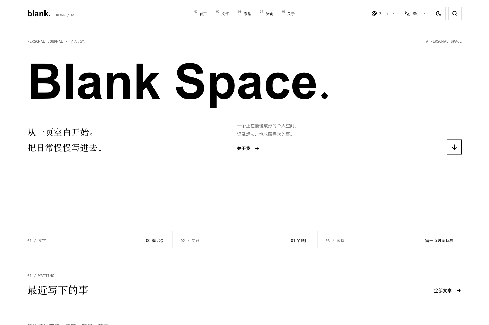
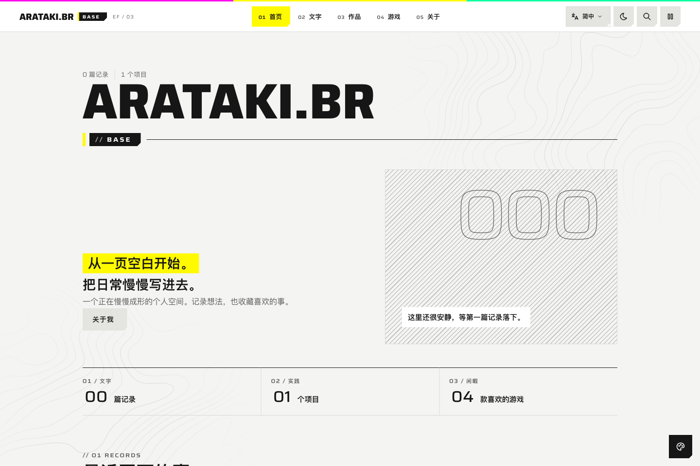
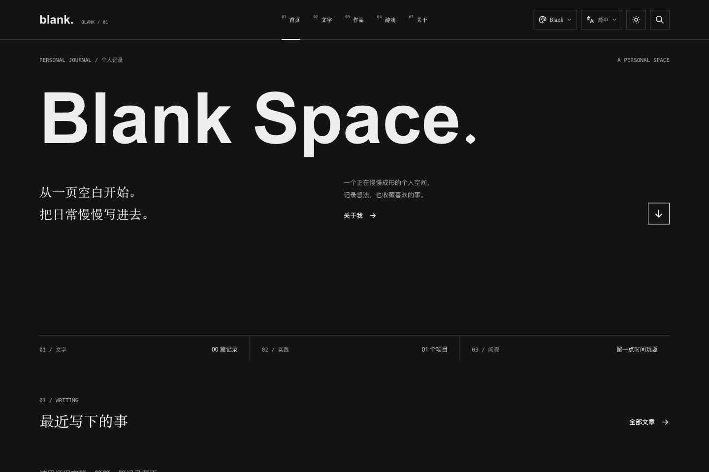
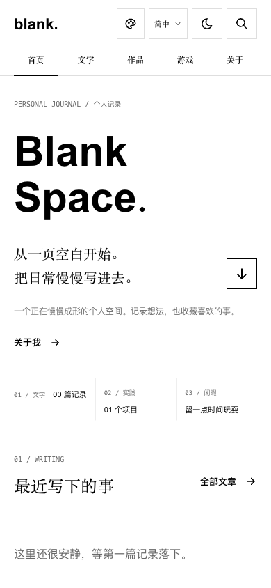
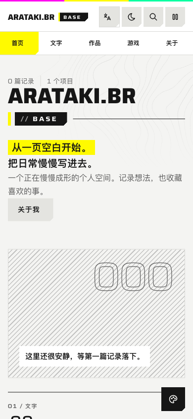
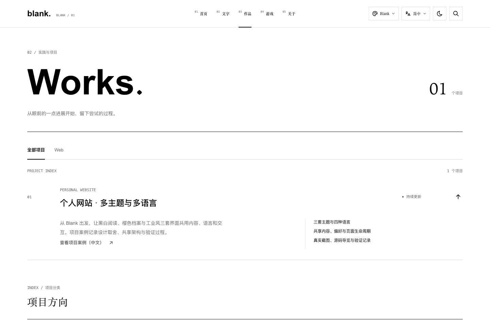

# 実際の画面 / 实际截图（历史快照）

[返回案例首页](../README.md)

本画廊目前保留的 6 张 PNG 均拍摄于 **2026-10-31**（本地生产构建，Chromium 156，桌面视口 1440 × 960，手机宽度视口 390 × 844，设备比例 1），早于 Blank 首页改版、樱色档案重做、明日方舟主题上线与自托管字体切换。手机图为桌面浏览器的窄视口模拟，不代表实体手机真机测试。

按 [`docs/ROADMAP.md`](../../docs/ROADMAP.md) 第 3.3 节约定，截图清单将在页头美术定稿并经站主批准后统一重拍（届时一并补齐樱色档案与明日方舟主题截图）。当前图片的路径、模式、尺寸与 SHA-256 记录在 [manifest.json](manifest.json)。

## Blank · 黑白阅读（2026-10-31 快照）

[访问当前线上页面](https://neroarataki.com/)

## 樱色档案 · 场景首页

[访问当前线上页面](https://neroarataki.com/themes/ema/)

截图暂缺：旧快照截图已于 2026-11-13 移出；待页头美术与重拍清单定稿后补充当前版本截图。

## 终末地工业风 · 结构与编号（2026-10-31 快照）

[访问当前线上页面](https://neroarataki.com/themes/endfield/)

## 明日方舟 · 档案终端

[访问当前线上页面](https://neroarataki.com/themes/arknights/)

该主题于 2026-11-26 新增，晚于本画廊的 2026-10-31 截图快照，待下一轮统一重拍时补入画廊。

## 浅色与深色（2026-10-31 快照）

## 窄视口（2026-10-31 快照）

以下图保持各自的真实视口尺寸，展示响应式首屏。

| Blank | 工业风 |
| --- | --- |
|  |  |

## 站内案例入口（2026-10-31 快照）

[访问当前线上作品页](https://neroarataki.com/projects/)

## 更新截图

1. 确定需要覆盖与新增的截图清单并取得站主确认。
2. 在仓库根目录运行 `npm run build` 并通过本地静态服务器打开 `dist/`。
3. 按 manifest 中的路径、视口、语言与颜色模式截屏，等待自托管字体与可见图片加载完成。
4. 同步更新 `showcase/gallery/manifest.json`、`public/projects/ASSETS.json` 及四语图注，并重跑 `npm test`、`npm run build` 和 `npm run showcase:check`。
